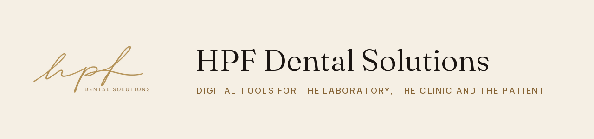

**HPF Dental Solutions** designs digital tools for the dental laboratory, the clinic and the patient, and builds web products for selected clients.  
Each tool starts from a real problem met in daily dental work, and is designed and built by [Hugo Philippe Fusaro](https://github.com/hugophilippefusaro), dental CAD designer and final-year dental student.

| Project | What it does | Status |
|---|---|---|
| [HPF Communicate](https://github.com/hpfdentalsolutions/hpf-communicate) | Clinical communication platform between laboratories and the design studio | In production |
| [HPF PhotoFlow](https://github.com/hpfdentalsolutions/hpf-photoflow) | Dental photography workflow, from the camera to an annotated protocol | In use |
| [HPF Dental Viewer](https://github.com/hpfdentalsolutions/hpf-dental-viewer) | 3D dental visualization with case sharing by link | In production |
| [HPF CAD Lab](https://github.com/hpfdentalsolutions/hpf-cad-lab) | Tools for a faster, safer exocad design workflow | In use |
| [HPF OS & NOVA](https://github.com/hpfdentalsolutions/hpf-os) | Local-first work environment with a voice assistant | In use |
| [HPF Companion](https://github.com/hpfdentalsolutions/hpf-companion) | Digital patient experience | Prototype |
| [HPF Whitening Protocol](https://github.com/hpfdentalsolutions/hpf-whitening) | At-home whitening, guided step by step | Live |
| [Vini d'Eccellenza Platform](https://github.com/hpfdentalsolutions/vini-deccellenza-platform) | Premium storefront and catalogue for an Italian wine merchant | Prototype |

These repositories are documentation only: the source code is proprietary and stays private.  
Screenshots use demonstration or synthetic data.

[hpfdentalsolutions.com](https://hpfdentalsolutions.com)
